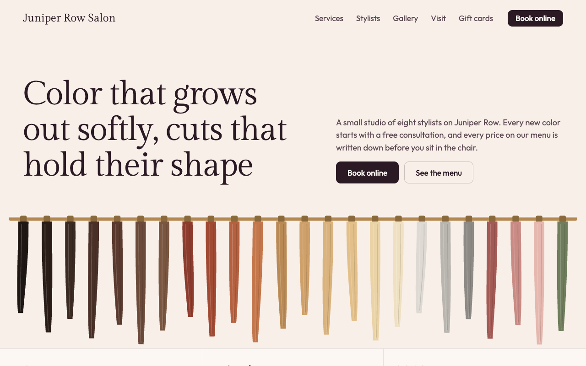

# Juniper Row Salon: salon website template

A website for a hair or beauty salon: a services menu with prices by stylist level and times, the stylists, a gallery, booking and gift card links, and the salon's policies. Built with Astro as a fully static site.



[](https://console.cloudzyro.com/new?repo=https://github.com/Cloudzyro/template-salon)

## What's included

- Home page with a colorist's swatch ring drawn in SVG, quick facts, the menu at a glance, how a visit goes, some of the team, recent work and gift cards
- Services menu with categories, a starting price per stylist level, durations and notes, laid out as aligned tables
- Stylists page grouped by level, with specialties, days in the studio and a "Book with" link for each person
- Gallery of illustrated looks with the stylist who did them, ready to swap for your photos
- Visit page with hours, address, parking, policies (consultations, cancellations, running late, prices) and a question form that works without a server
- Book online and gift card buttons that go to any links you choose
- Hair salon structured data, Open Graph tags, sitemap, robots.txt and favicon
- Responsive down to 360px, keyboard friendly, visible focus styles and reduced motion respected
- No tracking and no third-party scripts

## Run it locally

You need Node 22.23 or newer and pnpm.

```bash
pnpm install
pnpm dev       # http://localhost:4321
pnpm build     # static site in dist/
pnpm preview   # serve the build
```

## Make it yours

- **Content:** everything lives in `src/data/site.ts`: name, address, hours, the menu and prices, stylist levels, stylists, gallery looks and policies.
- **Booking and gift cards:** set `bookingUrl` and `giftCardUrl` in `src/data/site.ts` (Vagaro, Square Appointments, Fresha, Boulevard, GlossGenius or your own pages). A stylist can have their own `bookingUrl`.
- **Prices:** each service has a price per level; use `null` where a level doesn't offer it. Rename or remove levels in `levels`.
- **Question form:** set `PUBLIC_FORM_ENDPOINT` to a form service address (Formspree, Basin, a Supabase function or similar). With no endpoint set, the form shows a short note and opens the visitor's email app addressed to your `email`.
- **Site address:** set `SITE_URL` (for example `https://www.yoursalon.com`) so the sitemap, canonical links and social previews use it.
- **Colors and fonts:** the variables at the top of `src/styles/global.css`. Fonts are Gilda Display and Outfit, self-hosted through Fontsource.
- **Photos:** stylist portraits and gallery looks are SVG placeholders in `src/components/Portrait.astro` and `src/components/LookArt.astro`. Put your photos in `src/assets/` and use Astro's `<Image>` component in their place.
- **Social preview image:** replace `public/og.png` (1200 x 630).

Copy `.env.example` to `.env` to set the variables locally. On Cloudzyro, add them in your site's environment settings.

## Deploy

Click the button above to make your own copy and put it online, or push your copy to GitHub and connect the repository in the Cloudzyro console. It builds with `pnpm build` and serves the static `dist/` folder.

## Stack

- [Astro](https://astro.build) 7, static output
- `@astrojs/sitemap`
- Gilda Display and Outfit via Fontsource
- Plain CSS and a few lines of TypeScript for the form

## License

MIT, see [LICENSE](./LICENSE).
